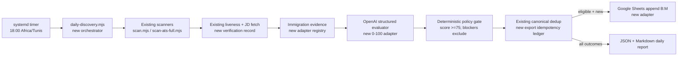

# Personalized European Job-Discovery Agent — Implementation Plan

## A. Executive Summary

Career-Ops can be extended into a local-first, non-applying, daily European job-discovery agent without replacing its discovery architecture. The target run is a single top-level Node command, invoked daily at 18:00 `Africa/Tunis`, that discovers jobs, verifies them, scores each job against the candidate’s CV, applies deterministic eligibility and threshold gates, deduplicates, appends only eligible jobs to the existing Google Sheet, and emits an auditable local report.

The smallest sound design reuses `scan.mjs`, `scan-ats-full.mjs`, `providers/`, `check-liveness.mjs`, `fetch-jd.mjs`, `evaluation-cache.mjs`, `url-key.mjs`, the scan-history/pipeline locks, and the existing file-first data root. New work should be a narrow orchestration layer plus adapters for a 0–100 evaluator contract, immigration evidence, Google Sheets, run state, and reporting. Do not create a database, service mesh, frontend, or application-submission workflow.

Candidate decision (2026-10-29): use the locally installed Codex CLI through its saved ChatGPT login for per-vacancy evaluation; do not require an OpenAI API key. The evaluator invokes `codex exec` ephemerally, read-only, and with a JSON Schema output contract, then applies the same deterministic validation/gates. Keep the direct OpenAI API adapter as an optional fallback for a future always-on deployment. Use `systemd` user service + timer on Ubuntu first; use an always-on VM only if the workstation cannot reliably be awake and online.

### Verified preconditions and current checkout state

- The checkout is on `main`; the only pre-existing untracked path is `.serena/`. It must remain untouched.
- Declared Node dependencies are installed locally, including the Playwright runtime. `node intake.mjs`, `node doctor.mjs`, and `npm run lint` have been run successfully; `npm run lint` checked 1,792 `.mjs` files with Node's per-file fallback because this environment uses Node 24.
- At the initial audit, user-layer files were absent. An approved intake has since created `cv.md`, `config/profile.yml`, and `modes/_profile.md` from the three CV PDFs in `documents/cv/`. `portals.yml` and `config/daily-discovery.yml` now configure Netherlands, France, Belgium, Denmark, Luxembourg, and Sweden; `modes/_custom.md`, `data/applications.md`, `data/pipeline.md`, `data/scan-history.tsv`, and `data/scan-runs.tsv` remain absent.
- Candidate facts are source-backed and nine public discovery sources have been validated live (Adyen, SES, four WTTJ country feeds, VDAB, and The Hub feeds for Denmark and Sweden). The initial six-country inventory is viable; add measured redundancy only when dry-run evidence shows a country/source gap, before persistent discovery writes are enabled.
- No Google Sheets integration exists in the repository. The target sheet was not accessed.

## B. Current Repository Architecture

### Layout and boundaries

Career-Ops is a Node ESM project (`package.json`, Node `^22.13.0 || >=23.4.0`) with root-level single-purpose `.mjs` scripts, `providers/` adapters, `lib/` helpers, `modes/` AI instructions, `templates/`, `tests/`, and an optional Go terminal dashboard in `dashboard/`. `ARCHITECTURE.md` and `DATA_CONTRACT.md` establish a strict system/user boundary. User data resolves through `path-resolver.mjs` rather than the working directory; canonical user files are human-readable and local. This supports the requested no-database default.

`test-all.mjs` auto-discovers `tests/**/*.test.mjs`; provider tests live in `tests/providers/`. `npm run lint` invokes `scripts/check-syntax.mjs`; `npm run verify` invokes `verify-pipeline.mjs`. Existing tests cover scanners, providers, filters, liveness, locks, scan history, listing fingerprints, deduplication, evaluation caching, report persistence, and tracker behavior.

### Discovery and source support

`scan.mjs` is the configured-portal scanner. It reads `{DATA_ROOT}/portals.yml`, dynamically loads providers from `providers/_registry.mjs`, filters title/location/content/age/visa/country-eligibility/salary, deduplicates against scan history, pipeline, and tracker, then writes `data/pipeline.md` and `data/scan-history.tsv` using locks. It supports `--dry-run`, `--verify`, JSON receipts, and run counters in `data/scan-runs.tsv`.

`scan-ats-full.mjs` is a complementary reverse-ATS scanner. It enumerates public Greenhouse, Lever, Ashby, Workday, iCIMS, BambooHR, Paylocity, and join.com board directories; applies the same filters; skips undated results by default; supports `--since`, `--liveness`, `--dry-run`, bounded concurrency, dead-board memory, 24-hour company-directory cache, atomic checkpoints every 500 boards, and `--resume`. It is valuable for progressive expansion but must be budgeted because a full sweep can be long.

The verified provider directory includes Greenhouse, Ashby, Lever, Workday, SmartRecruiters, Teamtailor, BambooHR, Breezy, Personio, Recruitee, Workable, iCIMS, SuccessFactors, Oracle Cloud, Taleo, Jobvite, ADP, eightfold, and many job-board adapters. `docs/SUPPORTED_JOB_BOARDS.md` is the authoritative supported-source inventory. It includes `wttj.mjs` (Welcome to the Jungle) and `vdab.mjs` (Belgium), plus Danish-oriented `thehub.mjs`; no verified APEC, HelloWork, LinkedIn Jobs, or Indeed core provider was found. LinkedIn is deliberately outside core authentication-free scanning; `docs/PLUGINS.md` lists an opt-in LinkedIn-alert-email plugin. A provider must use public/no-auth access; browser-only sources are standalone scanners (`scan-interamt.mjs`, `scan-dayforce.mjs`) rather than a general scraping framework.

### Evaluation and profile matching

The interactive scoring model is defined in `modes/_shared.md` and `modes/oferta.md`: A–G report blocks, a 1–5 global score, evidence rules, a hard work-authorization signal, a Machine Summary schema, and a report/tracker workflow. The mode is designed for AI coding CLIs, rather than unattended structured decisions.

`openai-eval.mjs` already supports OpenAI-compatible Chat Completions with `OPENAI_API_KEY`, `OPENAI_BASE_URL`, `OPENAI_MODEL`, `OPENAI_TIMEOUT_MS`, HTTPS/loopback safety checks, timeout, prompt-budget compression, streamed text, report persistence, and a limited `---SCORE_SUMMARY---` text block. It does **not** request JSON Schema output, validate a structured result, retry transient API failures, perform URL liveness, or expose the requested 0–100 decision contract. `gemini-eval.mjs` and `ollama-eval.mjs` offer alternatives. `eval-golden.mjs` provides replay/live golden-set evaluation infrastructure, but it currently asserts the existing textual summary format.

`evaluation-cache.mjs` provides a 24-hour, listing-fingerprint-backed local cache of public job facts, gated on a fresh active liveness result; it explicitly keeps private fit recomputed. This is reusable for minimizing repeat network and AI work.

### Verification, dates, persistence, and deduplication

`check-liveness.mjs`, `liveness-api.mjs`, `liveness-browser.mjs`, and `liveness-core.mjs` classify postings as active/expired/uncertain. Closure is only recorded when there is actual closure evidence; uncertain results must not be converted to closed. `fetch-jd.mjs` retrieves JD text from supported ATS APIs before browser fallback. `scan.mjs --verify` and `scan-ats-full.mjs --liveness` can keep known-expired jobs out before pipeline writes.

`url-key.mjs` normalizes canonical posting URLs and recognizes aggregator identities. `scan.mjs` also uses requisition IDs, configurable company/role/location/language dedup, `listing-fingerprint.mjs`, and `fingerprint-core.mjs` cross-listing signals. `precheck-duplicate.mjs` inspects tracker duplicates without writes. `data/scan-history.tsv` is restart-persistent historical dedup state, while `data/pipeline.md` is a candidate inbox. `pipeline-lock.mjs` protects concurrent pipeline and history writes. `dedup-tracker.mjs` is a repair tool for tracker rows, not an idempotent Sheets-write ledger.

### Scheduling, reporting, and exports

`docs/AUTOMATION.md` documents cron, launchd, Windows Task Scheduler, and an optional web scheduling queue. It documents unattended idempotent `node scan.mjs`, but no systemd unit/timer or complete discovery-to-AI-to-export orchestrator was found. The current scanner outputs terminal summaries and `scan-runs.tsv`; `scan-ats-full.mjs --md-out` can produce a digest. The repository has no Google Sheets client, service-account code, or sheet export module.

## C. Capability-Gap Matrix

| Requirement | Existing functionality | Relevant files | Gap | Recommended change |
|---|---|---|---|---|
| Candidate facts/CV | Data contract and profile templates | `cv.md` (missing), `config/profile.example.yml`, `modes/_profile.md` (missing) | No usable user profile in checkout | Create reviewed user-layer CV/profile in Phase 1; do not automate before it exists. |
| Configured official/ATS discovery | Public, zero-auth providers and filters; nine initial sources validate live | `portals.yml`, `scan.mjs`, `providers/`, `templates/portals.example.yml` | Initial country coverage exists; source redundancy should be evidence-driven | Add and validate compliant sources incrementally when dry-run coverage is weak, preserving source provenance and health checks. |
| Broad discovery | Reverse ATS scan, checkpoint/resume | `scan-ats-full.mjs` | No staged controller/budgets | Reuse as stages 2–7 of a bounded controller. |
| LinkedIn/Indeed/APEC/HelloWork | No verified core provider; LinkedIn alert plugin only | `docs/PLUGINS.md`, `providers/` | Auth/ToS/restriction risk | Do not scrape or bypass protections. Evaluate compliant opt-in feeds/API integrations per source; use employer URL when supplied. |
| Liveness/JD capture | API/browser liveness; known-ATS JD fetch | `check-liveness.mjs`, `liveness-*.mjs`, `fetch-jd.mjs` | Orchestrator does not capture standardized verification record | Compose existing verdicts in a new verification adapter. |
| 0–100 AI match | Existing 1–5 evidence-led evaluation | `modes/_shared.md`, `modes/oferta.md`, `openai-eval.mjs` | Different scale; text parsing; no schema/retry | New strict JSON evaluator and deterministic policy gate; leave existing evaluator working. |
| Immigration evidence | Work-auth hard-stop prompt guidance | `modes/oferta.md` | No country evidence adapters or IND register comparison | New immigration evidence module/registry and legal-name resolution workflow. |
| Progressive minimum-five search | Individual scanners are bounded/idempotent | `scan.mjs`, `scan-ats-full.mjs` | No target-driven stage controller | New `daily-discovery.mjs` with budgets and stage provenance. |
| Durable deduplication | URL/requisition/company-role/fingerprint history | `scan.mjs`, `url-key.mjs`, `listing-fingerprint.mjs`, scan history | No external-output idempotency ledger | Reuse scanner keys; add run/output ledger keyed by dedup key + sheet row receipt. |
| Google Sheet A:M append | None | No matching repository module | Full integration absent | New minimal Google Sheets REST adapter; append B:M only, read existing B:I/J fields, verify writes. |
| Daily report | Scan counters, Markdown digest option | `scan.mjs`, `scan-ats-full.mjs` | No end-to-end report schema | New JSON + Markdown per-run report derived from ledger events. |
| 18:00 Tunis automation | Cron/web scheduling docs | `docs/AUTOMATION.md`, `web/scripts/install-scan-schedule.sh` | No systemd implementation/full command | Add a user systemd service/timer and environment template in final ops phase. |

## D. Target Architecture

The orchestrator must be the only new top-level coordinator. Existing scanners remain source owners; existing liveness remains closure authority; existing URL/requisition logic remains the canonical discovery identity. A new daily result directory (proposed `output/daily-runs/YYYY-MM-DD/`) holds mutable, machine-readable attempt records and reports. A proposed `data/daily-discovery-ledger.jsonl` or TSV holds append-only, durable idempotency receipts; it is not a database and must be lock-protected/atomically appended.

Each candidate flows through: normalize identity → deduplicate before expensive work → retrieve/capture JD → liveness/authenticity check → extract deterministic facts → immigration evidence lookup → AI evaluation → validate JSON → deterministic policy decision → reserve/export record → Sheets write and read-after-write verification → report event. No code path calls application-form submission functionality.

## E. Technical Decisions

### Codex CLI over direct OpenAI API

Use Codex CLI because the candidate explicitly prefers their existing ChatGPT-authenticated local installation over API credentials. `codex exec` supports a non-interactive, ephemeral, read-only invocation and JSON Schema-constrained final output. The adapter validates its result before deterministic acceptance. The local systemd service must verify `codex login status` and report a failed/expired login distinctly; the laptop must remain online and logged in. Direct OpenAI API remains an optional fallback for environments where stable credentials, quotas, and shorter requests outweigh the no-key requirement.

Use `lib/codex-cli-evaluator.mjs` by default, with an abstraction that retains `lib/openai-client.mjs` as an optional fallback. Pin the optional Codex model through `CODEX_EVALUATOR_MODEL`, record the selected model, and validate every JSON response. Cache only public job facts using the existing `evaluation-cache.mjs` semantics; cache evaluation results by listing fingerprint + CV/profile revision + evaluator-contract version.

### Scoring and decision policy

The AI returns evidence; code decides. The initial contract totals 100: technical stack 30, responsibilities 20, seniority/experience 15, immigration feasibility 15, language 10, relocation 5, employment arrangement 5. It must identify source-backed skills, gaps, and uncertainty; it may not invent achievements. The candidate profile should model five experience years as a preference signal, not an automatic disqualifier.

Separate `match_score` from `eligibility_blockers`. A confirmed blocker excludes regardless of score. Score 74 excludes; score 75 passes only if authentic/open and blocker-free. Immigration classifications are `confirmed_vacancy_sponsorship`, `confirmed_employer_eligible`, `plausible`, `unknown`, and `confirmed_blocker`; they are not promises of visa approval.

### Immigration verification

Maintain a versioned, reviewed source registry (proposed `config/immigration-sources.yml` system template plus user overrides only for preferences). Netherlands logic must resolve the advertised employing legal entity, then compare it to the [IND Work register](https://ind.nl/en/public-register-recognised-sponsors/public-register-work). A match means employer eligibility/recognition, **not** vacancy sponsorship. The [IND highly-skilled migrant rules](https://ind.nl/en/residence-permits/work/highly-skilled-migrant) state that route requires a recognised sponsor. France and Belgium evidence should record [employer-led work authorisation](https://www.service-public.fr/particuliers/vosdroits/F2728) / [single-permit](https://republiquedecoree.diplomatie.belgium.be/en/travel-belgium/visa-belgium/visa-long-stays-over-90-days/employee-single-permit) routes; Denmark should distinguish a [Positive List](https://www.nyidanmark.dk/en-GB/Words-and-concepts/SIRI/The-Positive-Lists) route from a vacancy commitment; Luxembourg should record the [third-country salaried-worker route](https://guichet.public.lu/en/citoyens/immigration/plus-3-mois/ressortissant-tiers/salarie/salarie-pays-tiers.html), including its employer ADEM vacancy/certificate step, without promising eligibility. Official source URLs and retrieval dates are mandatory evidence fields.

### Google Sheets

Use Google Sheets v4 REST API with a least-privilege service account shared only with the target spreadsheet, or OAuth installed-app credentials if the sheet cannot be shared with a service account. Prefer service account operationally. Add a small native `fetch` implementation rather than a new Google SDK dependency unless OAuth refresh requirements make the SDK materially safer. Validate the live `Recommended Jobs` headers and A:M shape before write enablement. Append `B:M` only; never issue updates to A or historical rows. Read existing rows for dedup, then use a ledger reservation and exact post-write readback to make retries safe.

### Scheduling and reliability

Use a `systemd --user` service/timer with `Timezone=Africa/Tunis`, `Persistent=true`, `OnCalendar=*-*-* 18:00:00`, explicit working directory, `flock`/process lock, `EnvironmentFile` permissions 0600, and journald logs. The timer invokes only `node daily-discovery.mjs`; business logic stays in Node. A laptop that is powered off cannot meet daily reliability; document an optional small always-on Ubuntu VM after local dry-run stability, without containers/Kubernetes.

## F. Phased Implementation Roadmap

### Phase 0 — Baseline, Contracts, and Safe Test Harness

**Objective**

Establish a reproducible local baseline and the new daily-run contracts without live discovery or external writes.

**Current repository state**

`test-all.mjs`, scanner tests, fixtures, path resolution, locks, and data-contract rules exist; dependencies and user files are absent.

**Implementation tasks**

1. Install declared dependencies in a developer-controlled implementation session and record baseline `npm run lint`, focused tests, and `node doctor.mjs --json` results.
2. Add a proposed pure contract module, `lib/daily-discovery-contract.mjs`, defining candidate, verification, immigration, evaluation, decision, stage, and export-receipt schemas plus validators.
3. Add deterministic fixture directories under `tests/fixtures/daily-discovery/`; no real CV, credentials, or live listings.
4. Define output/run directory creation through `getCareerOpsRoot()` and atomic/lock conventions consistent with `scan.mjs`.

**Files involved**

- Modify: `package.json` only if a focused test script is justified.
- Create: `lib/daily-discovery-contract.mjs`, `tests/daily-discovery-contract.test.mjs`, fixture files.

**Dependencies**

None.

**Technical considerations**

No behaviour change to current scan/evaluation commands. Schema versions must be explicit so cached/ledger data can evolve safely.

**Testing and validation**

Run `npm run lint`, `node test-all.mjs --only daily-discovery-contract`, and existing scan/liveness focused suites.

**Acceptance criteria**

- Invalid decision/evidence/export records fail validation deterministically.
- Fixtures require no network or credentials.
- Existing test discovery still works.

**Deliverable**

Validated local contracts and fixture foundation.

**Out of scope**

CV intake, discovery runs, model calls, Sheets, scheduling.

**Estimated effort**

6–10 hours.

**Completion checklist**

- [x] Implementation complete.
- [ ] Tests passing.
- [ ] Acceptance criteria verified.
- [ ] Documentation updated.
- [ ] Existing functionality preserved.

### Phase 1 — Candidate Profile and European Search Configuration

**Objective**

Create reviewed candidate facts and a European discovery configuration from the actual CV.

**Current repository state**

The repository’s user layer supports `cv.md`, `config/profile.yml`, `modes/_profile.md`, and `portals.yml`; Phase 1 configuration and the initial Phase 2 source inventory are now present.

**Implementation tasks**

1. Obtain the user’s actual CV and explicitly confirm source-backed claims; create `cv.md` and `config/profile.yml` using `config/profile.example.yml`.
2. Add user targeting to `modes/_profile.md`: Tunisia residence, English/French C1, role priorities, country weights, sponsorship need, and preferences as non-hard filters.
3. Create `portals.yml` from `templates/portals.example.yml` with title/location filters, country coverage, selected official employer/ATS boards, and source-specific query configuration.
4. Add `config/daily-discovery.yml` with threshold 75, target 5/preferred 10–15, countries/weights, allowed stages, budgets, age windows, and disabled write mode by default.
5. Validate profile/portals using existing validation commands and preserve the system/user boundary.

**Files involved**

- Create user-layer: `cv.md`, `config/profile.yml`, `modes/_profile.md`, `portals.yml`, `config/daily-discovery.yml`.
- Reuse: `config/profile.example.yml`, `templates/portals.example.yml`, `validate-profile.mjs`, `validate-portals.mjs`.

**Dependencies**

Phase 0.

**Technical considerations**

The provisional profile must be replaced or confirmed from CV facts. Do not put user-specific facts in `modes/_shared.md`.

**Testing and validation**

Validate configuration locally, test title/location filters against fixtures, and run scanner `--dry-run` only after sources are configured.

**Acceptance criteria**

- Five priority countries have meaningful configured coverage.
- No undocumented hard exclusion rejects related roles, GCP exposure, or seven-year requirements automatically.
- No secrets or CV facts enter system files.

**Deliverable**

Validated, source-backed candidate and discovery configuration.

**Out of scope**

Scheduled execution, real evaluation, Sheets writes.

**Estimated effort**

5–12 hours, dependent on CV availability and employer/source choices.

**Completion checklist**

- [ ] Implementation complete.
- [ ] Tests passing.
- [ ] Acceptance criteria verified.
- [ ] Documentation updated.
- [ ] Existing functionality preserved.

### Phase 2 — Discovery Inventory and Source Coverage

**Objective**

Configure and test compliant European discovery coverage using existing scanners before adding sources.

**Current repository state**

`scan.mjs` and 90+ providers cover public ATS/job boards; `scan-ats-full.mjs` supports broad ATS scans. The initial target configuration has nine live sources across all six target countries; future redundancy is evidence-driven.

**Implementation tasks**

1. Categorize configured sources by country, provider, official-employer versus aggregator, authentication status, age/date availability, expected rate limits, and fallback stage.
2. Run `audit-portals.mjs`, `verify-portals.mjs`, and dry scans against configured boards; fix configuration before adding code.
3. Enable core providers first: Greenhouse, Ashby, Lever, Workday, SmartRecruiters, Teamtailor, Personio/Recruitee/Workable as reachable; add `wttj`, `vdab`, and `thehub` only after source validation.
4. Add a provider only when an important compliant source has no existing adapter; follow `providers/ADDING_A_PROVIDER.md`, pure-parser tests, pacing, retry, SSRF guard, and source policy review.
5. Explicitly keep LinkedIn, Indeed, APEC, and HelloWork as unsupported until a permitted/authenticated integration is approved; do not build anti-bot automation.

**Files involved**

- Modify user config: `portals.yml`, `config/daily-discovery.yml`.
- Potential new code only if warranted: `providers/<source>.mjs`, `tests/providers/<source>.test.mjs`, `docs/SUPPORTED_JOB_BOARDS.md`.

**Dependencies**

Phase 1.

**Technical considerations**

Prefer configuration to provider code. Respect rate limits and public endpoint terms; source failures must become report events, not silent zero-results.

**Testing and validation**

Provider parser fixtures, `node test-all.mjs --only providers/<source>`, dry-run scan JSON receipts, portal audit/verification.

**Acceptance criteria**

- Every enabled portal is claimed by a loaded provider or explicitly handled.
- All six priority countries have at least one configured compliant discovery path; add a second independent source where current coverage is single-source.
- No restricted source is scraped through a bypass.

**Deliverable**

A documented, validated discovery inventory and configuration.

**Out of scope**

Target-count progression, AI score, and external export.

**Estimated effort**

8–20 hours; source reachability and policy constraints are the uncertainty.

**Completion checklist**

- [ ] Implementation complete.
- [ ] Tests passing.
- [ ] Acceptance criteria verified.
- [ ] Documentation updated.
- [ ] Existing functionality preserved.

### Phase 3 — Structured 0–100 OpenAI Evaluation

**Objective**

Add validated, auditable per-job scoring without changing the existing 1–5 evaluator.

**Current repository state**

`openai-eval.mjs` makes one streamed text request and parses a textual summary; `evaluation-cache.mjs` supports reusable public facts.

**Implementation status (2026-10-29)**

The focused evaluator is implemented as `lib/europe-job-evaluator.mjs`, `lib/openai-client.mjs`, `lib/codex-cli-evaluator.mjs`, and `evaluate-europe-job.mjs`. `daily-discovery.mjs` defaults to the Codex CLI backend, which uses saved ChatGPT authentication, an ephemeral read-only sandbox, JSON Schema output, and deterministic validation. The direct OpenAI adapter remains optional. No live model evaluation was performed during implementation.

**Implementation tasks**

1. Add `lib/openai-client.mjs` with HTTPS, timeout, bounded exponential retry for retryable 408/429/5xx/network failures, request correlation ID, and redacted errors.
2. Add `lib/europe-job-evaluator.mjs` and `evaluate-europe-job.mjs` to build a versioned prompt from primary CV/profile sources and a verified JD.
3. Require schema-valid JSON: score total/breakdown, matches/gaps, each evidence quote/source, language assessment, employment arrangement, immigration classification, blockers, uncertainty, model metadata.
4. Implement deterministic JSON validation/retry-on-invalid-output, then reject unvalidated output rather than guessing.
5. Implement code-side policy gates: score >=75, confirmed blocker rejection, and no score override.
6. Key cache entries by listing fingerprint, CV/profile revision, evaluator schema version, and JD content hash; reuse public facts only under existing cache liveness rules.
7. Extend `eval-golden.mjs` or add a focused evaluator harness with offline JSON fixtures and threshold boundary cases.

**Files involved**

- Create: `lib/openai-client.mjs`, `lib/europe-job-evaluator.mjs`, `evaluate-europe-job.mjs`, `tests/europe-job-evaluator.test.mjs`, evaluator fixtures.
- Reuse/possibly modify: `evaluation-cache.mjs`, `eval-golden.mjs`, `config/daily-discovery.yml`.

**Dependencies**

Phases 0–1.

**Technical considerations**

Use the saved Codex CLI login by default at runtime; `OPENAI_API_KEY` is needed only when the optional API fallback is selected. Do not reuse `openai-eval.mjs` output parsing for acceptance decisions; preserve it as a backward-compatible CLI. Record model, prompt/contract version, usage, retries, and evidence provenance.

**Testing and validation**

Mock HTTP server tests for success, malformed JSON, 429/5xx retry, timeout, and no retry for 401/403; golden fixtures; exact 74/75 score boundaries; 95-plus blocker exclusion.

**Acceptance criteria**

- Every accepted decision has schema-valid evidence and deterministic policy result.
- 74 is rejected; 75 may proceed; 95 with confirmed blocker is rejected.
- No network credential is required for unit tests.

**Deliverable**

Tested structured evaluator and deterministic decision gate.

**Out of scope**

Live Sheet writes and scheduling.

**Estimated effort**

16–28 hours.

**Completion checklist**

- [ ] Implementation complete.
- [x] Tests passing.
- [x] Acceptance criteria verified.
- [x] Documentation updated.
- [x] Existing functionality preserved.

### Phase 4 — Vacancy and Immigration Verification

**Objective**

Produce evidence-based authenticity, liveness, publication-date, and immigration assessments before acceptance.

**Current repository state**

Liveness and API JD fetch exist; no formal immigration evidence module or legal-entity-to-IND workflow exists.

**Implementation status (2026-10-29)**

Implemented `lib/vacancy-verifier.mjs`, `lib/provider-jd.mjs`, and `lib/immigration-evidence.mjs`, with offline fixtures. The verifier composes existing API/browser liveness and JD fetch interfaces through injectable dependencies, preserves unknown publication dates, classifies expired/unverifiable/blocked records without guessing, and requires an active listing plus JD before calling a candidate application-ready. WTTJ public Algolia profile text and The Hub public JobPosting JSON-LD now supply source-specific JD evidence; a current public discovery-feed listing is only a liveness fallback when direct access is uncertain, never proof that submission succeeded. Netherlands IND matching is exact normalized legal-name matching against a separately supplied, freshness-checked snapshot; its result is explicitly employer eligibility, never a vacancy sponsorship promise. The evaluator policy can consume confirmed verification blockers deterministically. Snapshot refresh remains an operations prerequisite.

**Implementation tasks**

1. Add `lib/vacancy-verifier.mjs` that composes `fetch-jd.mjs`, liveness APIs/browser, official application URL preference, posting-date normalization, and uncertainty outcomes.
2. Add `config/immigration-sources.example.yml` and `lib/immigration-evidence.mjs` with official source descriptors, refresh metadata, country route logic, and classifications.
3. Implement Netherlands legal-entity matching as a conservative normalized-name workflow against a downloaded/versioned IND Work-register snapshot; retain source URL/date and match confidence; never equate register match with vacancy sponsorship. **Completed with a supplied snapshot; refresh workflow remains deferred.**
4. Implement France, Belgium, Denmark, Luxembourg route evidence as country context plus JD/employer evidence, not an eligibility guarantee. Make source snapshot refresh a separately logged process with fixture support.
5. Parse confirmed blockers from JD text deterministically where clear (for example, explicit no sponsorship or authorization required without support), preserve verbatim evidence, and otherwise leave unknown.
6. Require active liveness for application-ready acceptance; classify bot wall/insufficient evidence as `unverifiable`, not closed, and exclude it under the requested verification policy while reporting it.

**Files involved**

- Create: `lib/vacancy-verifier.mjs`, `lib/immigration-evidence.mjs`, `config/immigration-sources.example.yml`, fixtures/tests.
- Reuse: `check-liveness.mjs`, `liveness-*.mjs`, `fetch-jd.mjs`, `providers/_http.mjs`.

**Dependencies**

Phases 0–3.

**Technical considerations**

Official routes are evidence context only. Snapshot retrieval should have a fixed URL, checksum/modified date, TTL, manual review fallback, and no live scrapes in unit tests.

**Testing and validation**

Liveness fixture tests, IND exact/ambiguous/no-match tests, date-known/date-unknown tests, explicit blocker/non-blocker/unknown tests, source-staleness tests.

**Acceptance criteria**

- An application-ready candidate has original URL, liveness evidence, date status, and immigration record.
- IND recognition is labeled employer eligibility, not job sponsorship.
- Confirmed blocker always reaches policy exclusion.

**Deliverable**

Reusable verification and immigration evidence layer.

**Out of scope**

Visa applications, legal advice, live Sheets writes.

**Estimated effort**

20–36 hours; legal-entity matching/data availability is the main uncertainty.

**Completion checklist**

- [ ] Implementation complete.
- [ ] Tests passing.
- [ ] Acceptance criteria verified.
- [ ] Documentation updated.
- [ ] Existing functionality preserved.

### Phase 5 — Progressive Search Orchestration

**Objective**

Deliver a bounded, target-aware daily search controller that continues toward five qualifying jobs without fabricating results or weakening gates.

**Current repository state**

Scanners are independently idempotent and bounded; there is no target-driven controller.

**Implementation status (2026-10-29)**

Implemented the controller core in `lib/progressive-search.mjs`, restart-safe local state in `lib/daily-run-store.mjs`, JSON receipt adapter in `lib/scanner-receipt-adapter.mjs`, verification/evaluation adapter in `lib/daily-candidate-assessor.mjs`, and `daily-discovery.mjs`. `--live-scan --source portals` explicitly invokes the configured `scan.mjs --dry-run --json` sources; `--source full-ats` retains reverse-ATS coverage. Candidates then pass through verification and, only with `--evaluate`, the structured OpenAI evaluator. It never writes pipeline/history/Sheets. Live scanning defaults to one stage; `--max-stages 1..8` is explicit to bound network/cost. `config/daily-discovery.yml` records the currently configured source provenance per priority country—not as a country quota or guarantee. A 2026-10-29 verification-only dry run read 2,032 portal listings and surfaced 10 candidates; none had sufficient liveness/JD evidence to become application-ready. Sheets remain out of scope.

**Implementation tasks**

1. Create `daily-discovery.mjs`, reading `config/daily-discovery.yml`; default `--dry-run` and explicit `--write-sheet` safety gate.
2. Implement stages: (1) six priority countries/preferred titles/7 days; (2) additional configured sources; (3) cities/regions; (4) 30 then 90 days only if still active; (5) adjacent roles; (6) compatible mid/senior breadth; (7) configured additional European countries; (8) credible unknown sponsorship/no blocker.
3. Allocate initial effort by country (NL 35, FR 25, BE 10, DK 10, LU 10, SE 10) and enforce at least one meaningful attempt per country before expansion.
4. At each stage: invoke existing scanner interfaces/config snapshots, merge candidates by canonical existing identity, pre-dedup before costly verification/evaluation, process only unprocessed candidate fingerprints, count only accepted and export-eligible records.
5. Add limits: per-stage source/query budgets, max candidates, max model calls, max wall-clock time, per-source cooldown, and no-progress stop criteria. Persist stage attempts/checkpoints so restart resumes safely.
6. Stop at preferred target 10–15 or when budget/exhaustion rules trigger; minimum-five is an effort target, not an all-or-nothing export requirement.

**Files involved**

- Create: `daily-discovery.mjs`, `lib/progressive-search.mjs`, `lib/daily-run-store.mjs`, `tests/progressive-search.test.mjs`.
- Reuse: `scan.mjs`, `scan-ats-full.mjs`, `pipeline-lock.mjs`, Phase 3–4 modules.

**Dependencies**

Phases 1–4.

**Technical considerations**

Prefer calling extracted library functions/child commands with structured receipts over parsing terminal prose. If existing scanner APIs cannot be safely invoked in-process, add a thin `--json` command adapter without rewriting scanner logic.

**Testing and validation**

Fully mocked stage fixtures: three accepted candidates forces next stage; five stops normal expansion; exhaustion at three appends those three to pending export set and records shortfall two; restart does not reevaluate candidates.

**Acceptance criteria**

- All priority countries are attempted each run.
- Three qualifying jobs triggers further discovery.
- Stages never relax score, authenticity, or confirmed-blocker gates.
- Exhaustion produces exact stage/source shortfall evidence.

**Deliverable**

Resumable, bounded progressive discovery command producing local candidate decisions.

**Out of scope**

Google Sheets and scheduler installation.

**Estimated effort**

20–32 hours.

**Completion checklist**

- [ ] Implementation complete.
- [ ] Tests passing.
- [ ] Acceptance criteria verified.
- [ ] Documentation updated.
- [ ] Existing functionality preserved.

### Phase 6 — Export Ledger and Google Sheets Synchronization

**Objective**

Append eligible jobs idempotently to `Recommended Jobs` while preserving columns A and historical records.

**Current repository state**

No Sheets client exists; local URL/requisition dedup is strong but has no external write receipt.

**Implementation tasks**

1. Implement `lib/google-sheets-client.mjs` and `sync-recommended-jobs.mjs` using Sheets v4 API and credential abstraction.
2. On setup and every write-enabled run, read/validate sheet metadata, tab existence, header names/order, A:M shape, and row behavior; refuse writes if unexpected.
3. Read existing B:I/J fields and derive normalized dedup keys using existing URL/requisition identity plus legal employer/title/location safeguards. Do not dedup only on title similarity.
4. Add a lock-protected append-only export ledger with states `reserved`, `written`, `verified`, `failed`; include candidate fingerprint/dedup key, intended B:M payload hash, API append response/range, and timestamp.
5. Allocate append range B:M only, never write A. Before retry, consult the ledger and sheet readback by dedup key/payload hash; on ambiguous network failure, read before retrying.
6. Perform a post-write read-after-write verification; report partial failures distinctly and retain retryable records.
7. Map fields exactly: Tunisia sent date, legal employer, title, country, location, known/unknown posting date, official application URL, dedup key, score, immigration route/classification, evidence URL, advertised salary.

**Files involved**

- Create: `lib/google-sheets-client.mjs`, `lib/sheet-export-ledger.mjs`, `sync-recommended-jobs.mjs`, `tests/google-sheets-client.test.mjs`, `tests/sheet-export-ledger.test.mjs`.
- Modify: `daily-discovery.mjs` to invoke sync only with explicit write enablement.
- Create user data at first live run: `data/daily-discovery-export-ledger.jsonl` (proposed).

**Dependencies**

Phases 0, 3–5 plus credentials and user authorization.

**Technical considerations**

The sheet URL/tab/header state is unverified in this plan by instruction. Use staging/test spreadsheet fixtures or mocked API until the user authorizes a setup validation. Do not alter `Search Rules`.

**Testing and validation**

Mock Sheets API for append success, timeout-after-acceptance, retry, schema mismatch, blank rows, historical low score, and readback mismatch. Test that requests target `Recommended Jobs!B:M` only.

**Acceptance criteria**

- Column A and historical rows are never updated/deleted.
- Repeated run/retry yields one row per vacancy.
- Score 74 and blocked 95 never form append requests.
- A failed/partial write is visible and safely recoverable.

**Deliverable**

Idempotent, append-only Sheets synchronization behind an explicit write switch.

**Out of scope**

Editing Search Rules, dashboarding, application submission.

**Estimated effort**

18–30 hours.

**Completion checklist**

- [ ] Implementation complete.
- [ ] Tests passing.
- [ ] Acceptance criteria verified.
- [ ] Documentation updated.
- [ ] Existing functionality preserved.

### Phase 7 — Reporting, Scheduling, and Operations

**Objective**

Make the end-to-end command observable and safely unattended on Ubuntu.

**Current repository state**

Scanner run summaries and automation documentation exist, but no full daily runner, systemd unit, or comprehensive report exists.

**Implementation tasks**

1. Create `lib/daily-report.mjs` to write `output/daily-runs/YYYY-MM-DD/run-<id>.json` and `.md` from event records.
2. Include timestamp/status; stage/source attempts; discovery/evaluation/rejection counters; country counts; five strongest records; gaps; URLs; immigration/date uncertainty; writes; exact shortfall and fallback history.
3. Add `ops/systemd/career-ops-daily.service`, `.timer`, and `ops/systemd/career-ops.env.example`; use a user unit, absolute Node/project paths, `Timezone=Africa/Tunis`, `Persistent=true`, `flock`, and journald.
4. Add `docs/DAILY_DISCOVERY_OPERATIONS.md` for installation, secret permission checks, manual dry run, failure investigation, restart/retry, and cloud-VM option.
5. Define exit codes: configuration/credential error, no source reachable, partial completion, export failure, and successful shortfall; preserve report regardless of run outcome.

**Files involved**

- Create: `lib/daily-report.mjs`, `tests/daily-report.test.mjs`, `ops/systemd/*`, `docs/DAILY_DISCOVERY_OPERATIONS.md`.
- Modify: `daily-discovery.mjs`, `package.json` script if appropriate.

**Dependencies**

Phases 3–6.

**Technical considerations**

`systemd` must not hold business logic. Local persistence needs a backed-up home/disk; a suspended/off laptop can only execute the Persistent missed run when it next resumes, not at 18:00 exactly.

**Testing and validation**

Report fixture snapshots, failed-stage reports, shell/unit syntax validation, `systemd-analyze verify` in a suitable Ubuntu implementation environment, and manual dry-run command.

**Acceptance criteria**

- A report exists for successful, partial, and failed attempts.
- The timer invokes one command and prevents overlaps.
- No report claims a five-job success if fewer were accepted/written.

**Deliverable**

Operational runbook, reports, and installable Ubuntu schedule artifacts.

**Out of scope**

Cloud deployment unless local availability has proved insufficient.

**Estimated effort**

12–20 hours.

**Completion checklist**

- [ ] Implementation complete.
- [ ] Tests passing.
- [ ] Acceptance criteria verified.
- [ ] Documentation updated.
- [ ] Existing functionality preserved.

### Phase 8 — End-to-End Readiness and Controlled Rollout

**Objective**

Prove the complete workflow with no accidental submissions or duplicate exports before enabling daily production writes.

**Current repository state**

The previous phases provide modular functionality; no live baseline currently exists.

**Implementation tasks**

1. Run deterministic end-to-end fixtures covering every acceptance case in Section G.
2. Execute live discovery in `--dry-run --no-write-sheet` mode for several days; inspect source quality, score calibration, immigration classifications, costs, and shortfalls.
3. Validate Sheets credentials/schema against an authorized test or target sheet in read-only mode; then authorize one controlled append and readback.
4. Review logs/reports, tune source budgets/configuration rather than threshold gates, establish backup/retention policy, and enable timer only after sign-off.
5. Document rollback: disable timer, preserve ledger/report artifacts, use read-before-retry for pending exports; never delete history as recovery.

**Files involved**

- Modify: configuration and docs only as evidence requires.
- Create: `tests/daily-discovery-e2e.test.mjs`, rollout checklist under `docs/`.

**Dependencies**

All prior phases.

**Technical considerations**

Daily five is an operational target. Do not tune model scores upward merely to satisfy volume. Keep application functionality uninvoked and excluded from runner imports.

**Testing and validation**

Full suite plus fixture E2E; several dry runs; one reviewed export; timer test execution under controlled conditions.

**Acceptance criteria**

- Production enablement is a deliberate configuration change after dry-run evidence.
- All report/retry/duplicate and no-apply safety checks pass.
- Known limitations and source gaps are documented.

**Deliverable**

Production-readiness evidence and controlled activation plan.

**Out of scope**

Automatic application submission, unsupported-source bypasses, unrelated UI work.

**Estimated effort**

12–24 hours across several calendar days.

**Completion checklist**

- [ ] Implementation complete.
- [ ] Tests passing.
- [ ] Acceptance criteria verified.
- [ ] Documentation updated.
- [ ] Existing functionality preserved.

## G. Test Strategy

Use the current `test-all.mjs` auto-discovery model. New business logic must be pure and fixture-driven; mock HTTP/OpenAI/Sheets rather than requiring keys, browsers, or external services. Keep provider-specific tests in `tests/providers/` and workflow behavior tests in `tests/`.

Required cases:

1. Score 74 is excluded and has no sheet append request.
2. Score 75 with active/open, no blocker can proceed.
3. Score 95 with confirmed no-sponsorship/work-authorization blocker is excluded.
4. Three qualified jobs causes the controller to enter the next eligible stage.
5. Exhaustion with three writes those three when export is enabled and reports a shortfall of two with stages/sources tried.
6. URL/requisition/cross-board variants produce one candidate/export.
7. A next-day repeat recognizes the history/ledger and does not re-add the vacancy.
8. Timeout after a Sheets append performs read-before-retry and produces no duplicate.
9. Tests assert every Sheets write range is B:M and historical/A values are untouched.
10. Static/import tests ensure the daily runner never imports/calls `prepare-application.mjs` or application submission paths.

Run unit tests on every change; focused scanner/liveness/provider suites where shared behavior changes; `npm run lint`; and full `node test-all.mjs` before a production rollout. Add contract tests for AI malformed/missing evidence output, model retry limits, stale immigration source data, stage checkpoint resume, and file/lock failure paths.

## H. Configuration and Secrets

Non-secret user configuration:

- `cv.md`, `config/profile.yml`, `modes/_profile.md`, `portals.yml`.
- Proposed `config/daily-discovery.yml`: score threshold, country weights, source/stage budgets, age windows, max model calls, output mode, source toggles.
- Proposed immigration source registry/cache configuration and generated snapshots under `data/`.
- Persistent local state: existing `data/scan-history.tsv`, `data/pipeline.md`, `data/scan-runs.tsv`; proposed run/output ledger and `output/daily-runs/`.

Credentials, supplied only through a 0600 `EnvironmentFile` or OS secret store and never committed:

- Default evaluator: existing `codex login` ChatGPT authentication, optional `CODEX_EVALUATOR_MODEL`, and optional `CODEX_EVALUATOR_TIMEOUT_MS`.
- Optional API fallback only: `OPENAI_API_KEY`, `OPENAI_MODEL`, optional `OPENAI_BASE_URL`, `OPENAI_TIMEOUT_MS`.
- `GOOGLE_SHEETS_SPREADSHEET_ID=1FHJcYOm2nq7MHegIuE0_xsQN9BP0B2SpZCUz06iZfqU`, `GOOGLE_SHEETS_TAB=Recommended Jobs`.
- One of service-account JSON path/credential references or OAuth client/refresh-token references; never put JSON private keys in `config/` or Git.
- Optional explicit path overrides already supported by Career-Ops (`CAREER_OPS_ROOT`, `CAREER_OPS_DATA_DIR`, tracker/scan paths) must resolve safely through `path-resolver.mjs`.

## I. Risks and Open Questions

| Risk / unknown | Mitigation / phase |
|---|---|
| Actual CV missing | Phase 1 blocks automatic evaluation until reviewed user-layer sources exist. |
| Dependencies absent | Phase 0 installs only declared dependencies in an implementation session and records baseline. |
| Employer legal entity differs from brand | Conservative exact/alias matching; report ambiguity; no false IND confirmation. Phase 4. |
| Sponsorship absent from JD | Classify unknown/plausible, never confirmed; retain evidence/retrieval date. Phase 4. |
| Restricted job boards | Use permitted public feeds/official sites/plugins; do not defeat bot/auth controls. Phase 2. |
| Date missing/stale/closed | Preserve unknown dates; existing liveness closure evidence; exclude unverifiable by target policy. Phase 4. |
| AI inconsistency/cost/rate limits | Schema validation, golden tests, retries/backoff, fixed model/version, cache, budgets, audit metadata. Phase 3. |
| Fewer than five real matches | Progressive bounded effort and exact shortfall report; never manipulate scores. Phase 5. |
| Sheets schema/credentials differ | Read-only validation, strict header guard, B:M-only append, ledger/readback. Phase 6. |
| Local computer offline at 18:00 | Persistent systemd catch-up; move to a small always-on Ubuntu VM only after need is demonstrated. Phase 7–8. |
| Upstream Career-Ops updates | Keep extensions isolated; respect system/user data contract; test upgrades before pulling changes. |

## J. Final Definition of Done

- [ ] A user-level Ubuntu timer invokes one top-level command daily at 18:00 Africa/Tunis, with overlap protection.
- [ ] Each run makes meaningful attempts across Netherlands, France, Belgium, Denmark, Luxembourg, and Sweden, with configured weighted initial effort.
- [ ] Multiple compliant public sources/ATS providers are used and source failures are reported.
- [ ] Every evaluated vacancy is assessed against the actual, source-backed CV/profile with a validated 0–100 contract.
- [ ] Score <75 and confirmed eligibility blockers are deterministically excluded.
- [ ] Liveness, authenticity/application URL, dates, and immigration evidence/uncertainty are recorded before acceptance.
- [ ] Netherlands IND recognition is checked against the legal employer where resolvable and never overstated as job sponsorship.
- [ ] URL/requisition/cross-board and historical duplicates are not reevaluated/exported.
- [ ] Progressive stages continue when fewer than five eligible jobs are found, remain bounded, and report exact shortfalls.
- [ ] Eligible jobs append only B:M to `Recommended Jobs`; column A and historical data are untouched.
- [ ] Sheet writes are idempotent, verified, and recoverable after partial failures.
- [ ] Each run writes an auditable Markdown and JSON report.
- [ ] Tests cover all Section G critical cases without real credentials/services.
- [ ] No path submits or automatically applies for any job.

## Effort and sequencing summary

Estimated engineering effort is approximately 117–212 hours, excluding waiting for real-world dry-run observations and user decisions. The largest uncertainties are CV/profile completion, compliant source availability, legal-entity/immigration evidence quality, Google credential ownership, and the actual daily supply of qualifying openings. Start with **Phase 0**, then Phase 1; do not enable model calls, Sheets writes, or scheduling before those foundations are reviewed.
